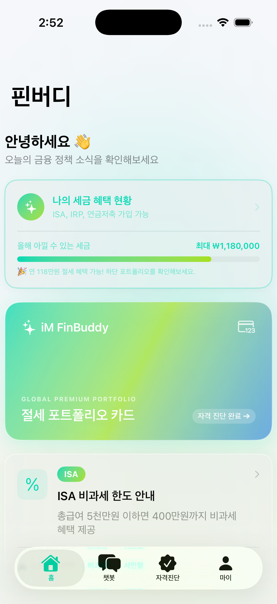
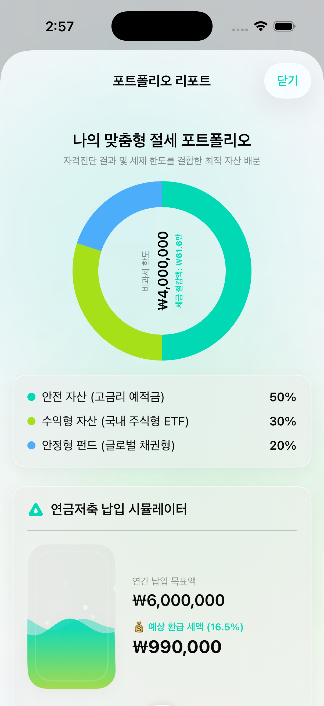
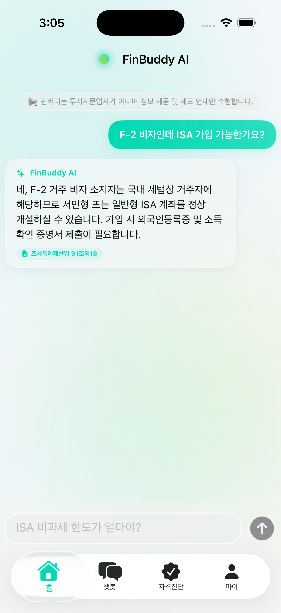

# 🏦 FinBuddy (핀버디) - 외국인 절세/자산 맞춤 지원 비서

> **iM금융그룹 제4회 개발경진대회 출품작**
> 한국 거주 외국인들의 실질적인 ISA/IRP/연금저축 절세 혜택 접근성 격차를 해소하는 개인 맞춤형 금융 자격 진단 및 RAG 챗봇 애플리케이션

---

## 🎨 주요 화면 및 디자인 설계 (토글 펼치기)

<b>📲 1. 홈 화면 (개인화 절세 게이지 & 3D 입체 반응 카드)</b>

 

  

<ul>
  <li><b>개인화 절세 전광판</b>: 자격진단 결과를 연동하여 올해 아낄 수 있는 소득 세제 혜택 총량을 동적 게이지바로 표현합니다.</li>
  <li><b>3D Parallax Glass Card</b>: 드래그 제스처에 반응해 3D 회전하며 그림자가 흐르는 프리미엄 카드 모듈을 탑재했습니다. 탭 시 맞춤 포트폴리오 리포트 시트를 띄웁니다.</li>
  <li><b>용어 사전 번역 칩</b>: 본문의 어려운 한자 금융 용어를 클릭 시 즉석에서 모국어 번역과 AI 쉬운 한 줄 해설을 카드 팝업으로 노출합니다.</li>
</ul>

<b>🧪 2. 포트폴리오 리포트 (액체 파동 시뮬레이터 슬라이더)</b>

 

  

<ul>
  <li><b>60fps 유체 물리 캔버스</b>: SwiftUI TimelineView 기반으로 실시간 일렁이는 파동과 돈방울(Money Bubble)이 부력에 둥둥 뜨는 비커 슬라이더를 묘사했습니다.</li>
  <li><b>실시간 세액공제 환급 연산</b>: 슬라이더를 통해 납입액(최대 1,200만원)을 조절하면 예상 연말정산 환급금이 실시간 카운팅됩니다.</li>
</ul>

<b>💬 3. 챗봇 상담 (AI 고동 코어 & 글래스모피즘 버블)</b>

 

  

<ul>
  <li><b>Pulsing AI Core</b>: AI 브레인 구체가 상단 툴바에서 대기 시 서서히 박동하고, 연산 중일 땐 빠르게 공전하며 "생각하는 모션"을 피드백합니다.</li>
  <li><b>유리 질감 말풍선</b>: 유려한 thinMaterial 투명 말풍선과 RAG 출처(sources) 캡슐 뱃지를 배치해 고급감을 살렸습니다.</li>
</ul>

---

## 🛠 기술 스택

### Frontend (iOS Native)
- **SwiftUI**: 네이티브 모션 그래픽스 및 유려한 UI 아키텍처.
- **TimelineView & Canvas**: 60fps 물리 기반 액체 시뮬레이션 구현.
- **CoreImage (CIQRCodeGenerator)**: 은행원 단말 연동용 QR 코드 생성.
- **Combine & State**: UserDefaults 캐싱 연동을 통한 로컬 지속성 확보.

### Backend (Python FastAPI)
- **FastAPI**: 초경량 고성능 비동기 API 엔드포인트 제공.
- **OpenAI gpt-4o-mini**: RAG 챗봇 응답 모델 및 행원용 리포트 작성 에이전트.
- **FAISS & BM25**: 의미 검색과 한자어 키워드 검색을 RRF(Reciprocal Rank Fusion)로 융합한 하이브리드 검색엔진.
- **Kiwi**: 한국어 형태소 분석을 통한 토크나이저 고도화.

---

## 🚀 킬러 비즈니스 피처: B2B2C 행원 상담 QR 코드 연동
1. 고객이 앱 내에서 간단한 세제 자격을 진단받으면 전용 QR 코드가 발행됩니다.
2. iM뱅크 지점 창구 방문 시 은행원에게 QR 코드를 제시합니다.
3. 행원 단말기에서 QR 스캔 시, 고객의 앱 내 금융 검색이력, 대화 횟수, 추정 신용등급 및 행원 상담 팁이 적힌 **글래스모피즘 HTML5 종합 보고서(FastAPI)**를 웹뷰로 즉시 연동하여 금융 소외 계층의 대면 상담 만족도를 대폭 향상시킵니다.
